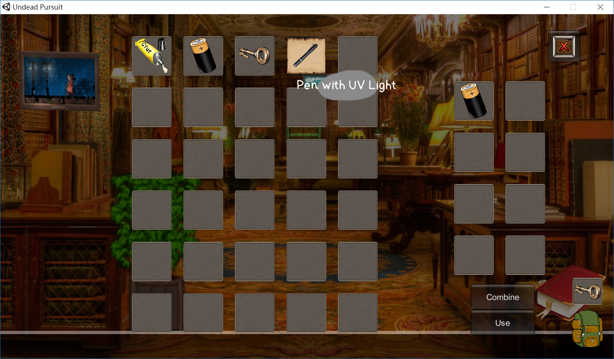
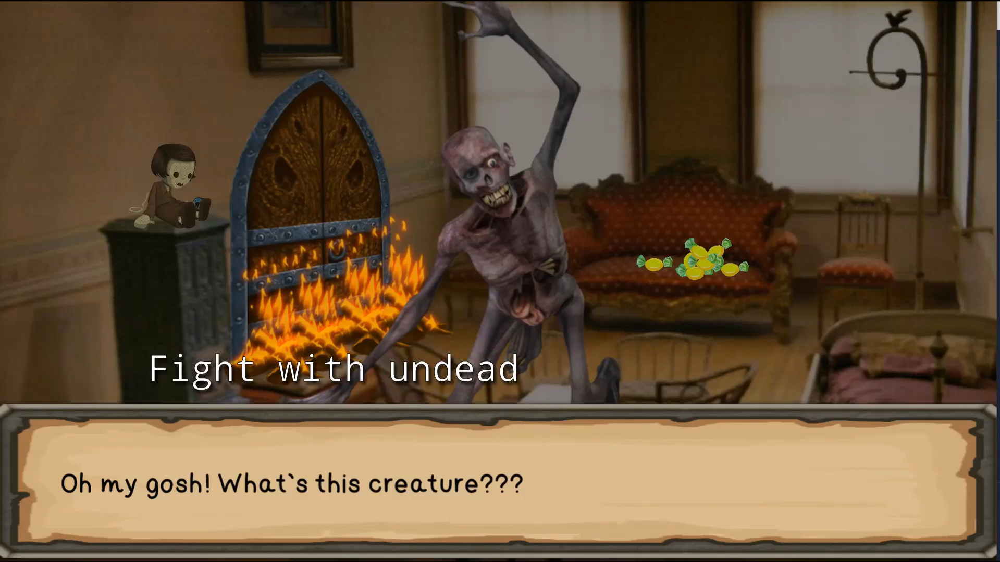
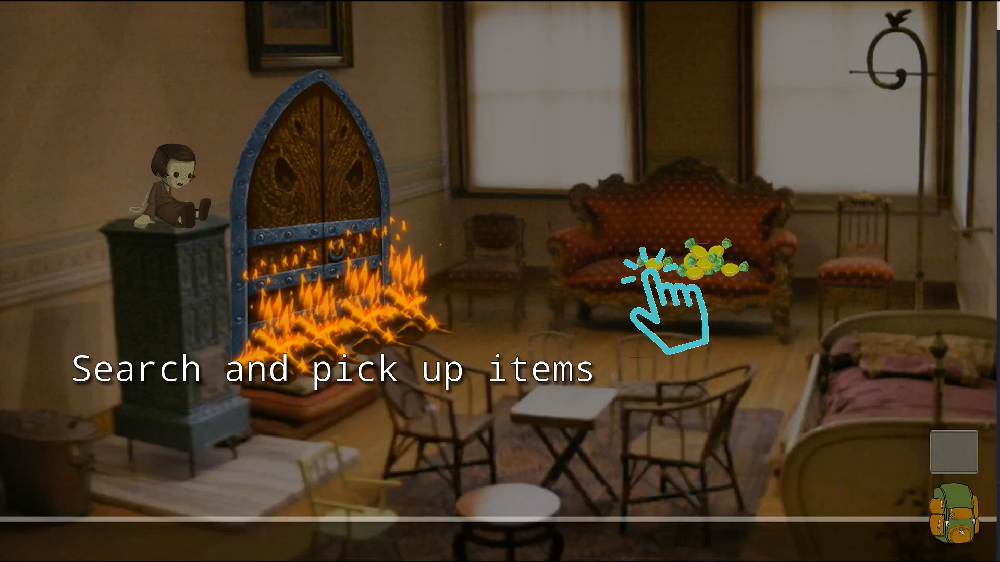

# Undead Pursuit

A 2D detective-themed adventure game developed as a university group project using **Unity and C#**.

## Overview

Undead Pursuit is an adventure game that combines exploration, puzzle-solving, and light combat. Players investigate their surroundings, collect important items and clues, and encounter undead enemies along the way.

This was my first 2D PC game project.

## My Contributions

As an Engineer on the project, I was responsible for implementing several gameplay systems:

- **Inventory System:** Implemented item collection and inventory management for key items and clues.
- **Dialogue System:** Developed dialogue interactions to support storytelling and player progression.
- **Combat Mechanics:** Implemented basic combat mechanics for encounters with undead enemies.

## Technologies

- Unity 2017.3.0f3
- C#

## Project Type

University group project.

## Screenshots

## Status

Completed university project.
